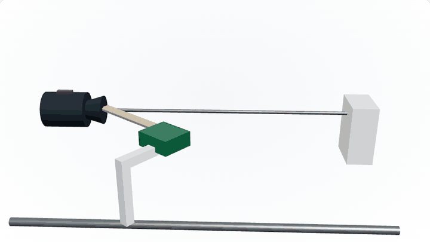
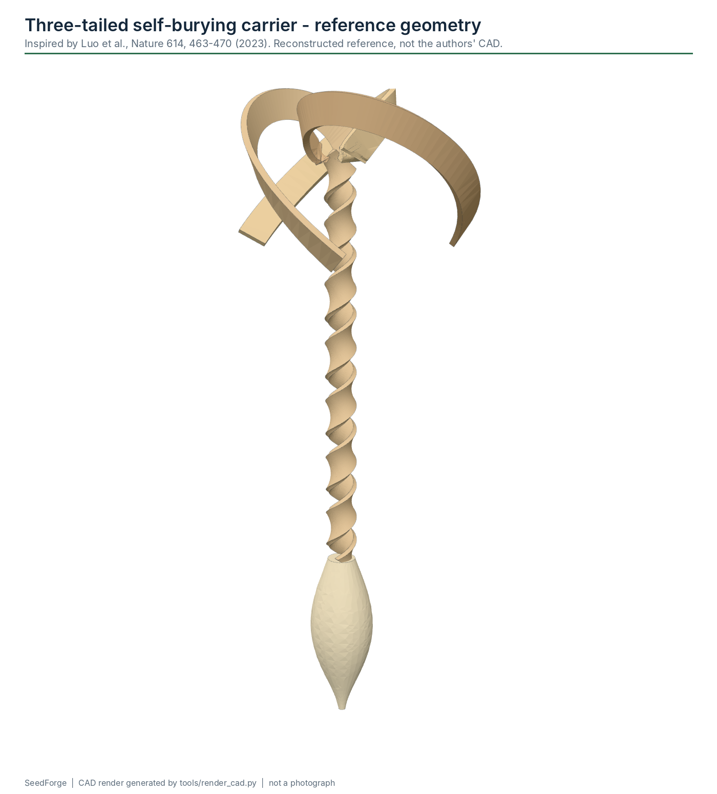

# SeedForge

An open-source modular manufacturing platform for
moisture-responsive wooden self-burying seed carriers.

[](https://github.com/Normansrule/seedforge/actions/workflows/test-python.yml)
[](https://github.com/Normansrule/seedforge/actions/workflows/test-firmware.yml)
[](https://github.com/Normansrule/seedforge/actions/workflows/validate-cad.yml)
[](https://github.com/Normansrule/seedforge/actions/workflows/build-docs.yml)
[](https://github.com/Normansrule/seedforge/actions/workflows/deploy-pages.yml)
[](LICENSE)

**Release v0.3.0-alpha (engineering revision R3.1). Status: designed, CAD-checked, firmware compile-tested, software unit-tested. The machine has not been physically built or validated yet.**


[**View interactive demo**](https://normansrule.github.io/seedforge/) ·
[**Read build guide**](docs/getting-started.md) ·
[**Download printable parts**](https://github.com/Normansrule/seedforge/releases/latest) ·
[**Explore CAD**](hardware/cad/README.md) ·
[**See electronics**](docs/electronics.md) ·
[**Run simulator**](docs/simulator.md)

## What it does



Luo et al. (*Nature* 614, 463-470, 2023) showed a three-tailed wooden seed carrier that is wound
from a thin wet veneer strip, dried into a coil, and then uncoils and re-coils with changes in
humidity until it drills itself into the soil. SeedForge is an attempt to make the **manufacturing
side** of that idea reproducible on a bench: feed a prepared strip under measured tension, wind it
on a 0.8 mm mandrel with synchronized rotation and traverse, check the coil with a camera, cut it,
demold it, and log every carrier.

This repository is **not** affiliated with the paper's authors or with UC Berkeley. It started as
an EECS 149 course project (archived in [`archive/eecs149-original/`](archive/eecs149-original/)).

## System architecture


| layer | hardware | job |
|---|---|---|
| Real-time controller | Arduino Uno | deterministic step generation (Timer1 ISR, Bresenham sync), limit switches, load cell, tension trip, E-stop feedback, state machine |
| Bridge / operator UI (optional) | Seeed XIAO ESP32-C3 | USB-C, BLE, Wi-Fi, status display; **not** safety-relevant; the Uno's own USB does the same job |
| Host | laptop / Raspberry Pi | camera, deterministic vision QA, recipes, run logs |
| Safety | E-stop NC contact | physically removes actuator power; a divider from the switched rail tells the Uno |

Details: [system overview](docs/system-overview.md) · [controls](docs/controls.md) ·
[protocol](docs/protocol.md) · [electronics](docs/electronics.md) · [safety](docs/safety.md).

## Module map


| module | function | v0.3 status |
|---|---|---|
| [M1](docs/modules/M1-feed-tension.md) | feed + tension (spool, dancer, load cell, guide) | designed, CAD-checked |
| [M2](docs/modules/M2-winding.md) | synchronized winding | designed, CAD-checked, firmware unit-tested |
| [M3](docs/modules/M3-clamp-cut-demold.md) | clamp + cut + demold | sequence SOFTWARE-TESTED (host + simulator); mounting open |
| [M4](docs/modules/M4-tail-forming.md) | auxiliary tail forming | experimental |
| [M5](docs/modules/M5-free-drying.md) | free drying | experimental |
| [M6](docs/modules/M6-assembly.md) | seed + tip + three-tail assembly | experimental |
| [M7](docs/modules/M7-vision-qa.md) | computer-vision QA | software tested on synthetic images |
| [M8](docs/modules/M8-output.md) | output storage | experimental |
| [M9](docs/modules/M9-xy-transfer.md) | XY transfer (optional) | upcoming |
| [M10](docs/modules/M10-drone-cassette.md) | drone cassette (optional, downstream) | concept |

## Core winder


The first build target is **one reliable automated core-winding cell**: M1 feed/tension, M2
synchronized winder, a fixed overhead camera with a back-light, and then M3 clamp/cut/demold.

* **One fastener size: M2** (2 mm metric screws, nuts, washers, thread-forming screws into printed
  pilots, M2.2 wood screws into the plywood). The NEMA17s are held by their bodies in W15/W16
  collars because their own face threads are M3; the load cell is clamped, not bolted.
* **Budget parts:** generic drivers and motors, a 12 V 3 A adapter, a USB board camera, a plywood
  camera mast, an LED-strip back-light. About $128 to buy if you already own an Uno, two NEMA17s and
  two A4988s ([BOM](hardware/bom/BOM.md)).

* Rotation: NEMA17 + A4988 at 1/16 step = 3200 microsteps per mandrel revolution, mini drill chuck
  on the motor shaft, 0.8 mm steel mandrel, far end supported in a PTFE bushing.
* Traverse: NEMA17 + T8x8 lead screw (400 microsteps/mm) on two 8 mm rods and LM8UU bearings.
* Guide angle, pitch, tension limits, rate, acceleration and turn count are **recipe variables**,
  never hard-coded. The W12 guide arm sets the angle over +-60 deg.
* The 18 mm plywood base is drilled from a printed template.

## Finished carrier



The reference carrier CAD (7-coil body, three tails, tip) is a **reconstructed reference** used to
size fixtures. Dimensions from the paper are marked SOURCE-SUPPORTED; tail and tip shapes are
RECONSTRUCTED. A plastic print of it is not a functional seed carrier. See
[carrier geometry](docs/carrier-geometry.md), including why the course target (4 mm strip at
45 deg) overlaps itself and cannot meet "no gap, no overlap".

## Validation status

Evidence levels used everywhere in this repository:
`SOURCE-SUPPORTED` · `ENGINEERING ASSUMPTION` · `RECONSTRUCTED REFERENCE` · `CAD-VALIDATED` ·
`PHYSICALLY TESTED` · `BIOLOGICALLY VALIDATED` · `FLIGHT-VALIDATED`, plus `SOFTWARE-TESTED` for code
that passes automated tests but has not run on hardware.

| item | highest level reached | evidence |
|---|---|---|
| Carrier reference dimensions | SOURCE-SUPPORTED / RECONSTRUCTED | [carrier-geometry.md](docs/carrier-geometry.md) |
| Printed machine parts (71) | CAD-VALIDATED (watertight, fit A1 Mini, M2 holes; 69 single-body, S01/T03 need repair) | [QA report](hardware/cad/QA_REPORT.md) |
| Core-cell layout | CAD-VALIDATED (static and swept interference check) | [core_cell_layout.json](hardware/cad/source/core_cell_layout.json) |
| Uno firmware | Compile-tested; hardware testing pending | `tests/firmware` (host unit tests under ASan/UBSan) |
| ESP32-C3 bridge | Compile-tested; hardware testing pending | `firmware/esp32` |
| Host, simulator, vision | unit-tested on synthetic data | `tests/` |
| Any wound carrier | **Not yet physically validated** | - |
| Biological performance | not tested | - |
| Drone payload | concept only, not flight-validated | - |

Full matrix: [docs/validation.md](docs/validation.md) and [`validation/status.yaml`](validation/status.yaml).

## BOM

| view | what it is | to buy (own Uno/motors/drivers) | buying everything |
|---|---|---|---|
| [A - minimum demonstrator](hardware/bom/A_minimum_demonstrator.csv) | the Phase-1 core cell plus M3 clamp/cut/demold and the fixed camera | about $128 | about $153 |
| [A + B - manufacturing bench](hardware/bom/B_manufacturing_bench.csv) | adds tails, drying, seed/tip tooling, XY transfer from a donor printer | about $225 | about $250 |
| [C - optional deployment](hardware/bom/C_optional_deployment.csv) | payload kit + a budget ArduPilot quad | about $154 (own charger + radio) | about $224 |
| C payload kit only | if an ArduPilot aircraft is already available | about $18 | about $18 |

Budget planning estimates for generic parts (USD, October 2026), not quotes; ESP32 bridge, display,
IMU and the drone companion computer are optional and not counted. See [BOM.md](hardware/bom/BOM.md).

## Build roadmap

Build in this order. Each phase has an acceptance gate in [docs/validation.md](docs/validation.md).
**Do not jump to Phase 8.**

```text
Phase 0   Material characterization          wet/dry dimensions, damage and break tension
   |
Phase 1   Feed + tension + synchronized winder   >= 20 consecutive cycles, exact turns
   |
Phase 2   Clamp + cutter + demold             20/20 cut + release without dragging
   |
Phase 3   Tail forming                        repeatable dried tail shape
   |
Phase 4   Free drying                         logged environment, no fixture deformation
   |
Phase 5   Seed / tip assembly                 one seed, three tails, no glue on active coils
   |
Phase 6   Computer-vision QA                  labelled real-image confusion matrix
   |
Phase 7   Automated transfer                  >= 50 transfers without drop or collision
   |
Phase 8   Deployment research                 bench release tests, mass/thrust margin, permissions
```

## Quick start (no hardware)

```bash
git clone https://github.com/Normansrule/seedforge.git && cd seedforge
python -m pip install -e ".[dev]"
python -m seedforge.simulator normal          # simulated winding cycle
python -m seedforge.vision demo               # deterministic vision QA on synthetic images
python -m seedforge.geometry                  # pitch / gap / guide-angle table
python -m pytest                              # Python tests
make -C tests/firmware                        # firmware core unit tests (g++)
python tools/build_cad.py                     # regenerate STEP/STL/3MF/GLB + CAD QA (needs CadQuery)
```

## Repository layout

```text
hardware/   cad/ (source, step, stl, 3mf, glb, QA), bom/, wiring/, drawings/, electronics/
firmware/   arduino/seedforge_core (Uno), esp32/seedforge_bridge (XIAO ESP32-C3)
software/   seedforge Python package: geometry, protocol, recipe, host, simulator, vision, deploy
website/    GitHub Pages site (Vite + TypeScript + Three.js)
docs/       documentation, diagrams, renders, module docs
tests/      firmware (C++ host tests), host, geometry
validation/ worksheets, run-log template, acceptance criteria, test procedures, status
datasets/   synthetic vision set; structure for real labelled images
archive/    original EECS 149 code and the supplied R3 package, unchanged
tools/      build scripts (CAD, renders, BOM, wiring, diagrams, module docs, release)
```

## Research reference

Luo, D., Maheshwari, A., Danielescu, A. et al. Autonomous self-burying seed carriers for aerial
seeding. *Nature* **614**, 463-470 (2023). <https://doi.org/10.1038/s41586-022-05656-3>

The paper's authors are not authors of this repository and have not reviewed it. No figures from
the paper are reproduced here. See [docs/references.md](docs/references.md) and
[CITATION.cff](CITATION.cff).

## Disclaimer

SeedForge is a research prototype. It is not an industrial production line, a certified machine,
a chemically validated wood-processing system, a biologically validated seed product or a
flight-certified payload. Rotating machinery, cutters, stepper drivers and batteries can injure
people. Releasing seeds into the environment needs permission and ecological review. Read
[DISCLAIMER.md](DISCLAIMER.md) and [docs/safety.md](docs/safety.md) before building anything.

## License

Software: MIT. Hardware design files: CERN-OHL-S-2.0. Documentation and renders: CC BY-SA 4.0.
`archive/` is excluded. Details: [LICENSE](LICENSE) and [docs/project/licensing.md](docs/project/licensing.md).
