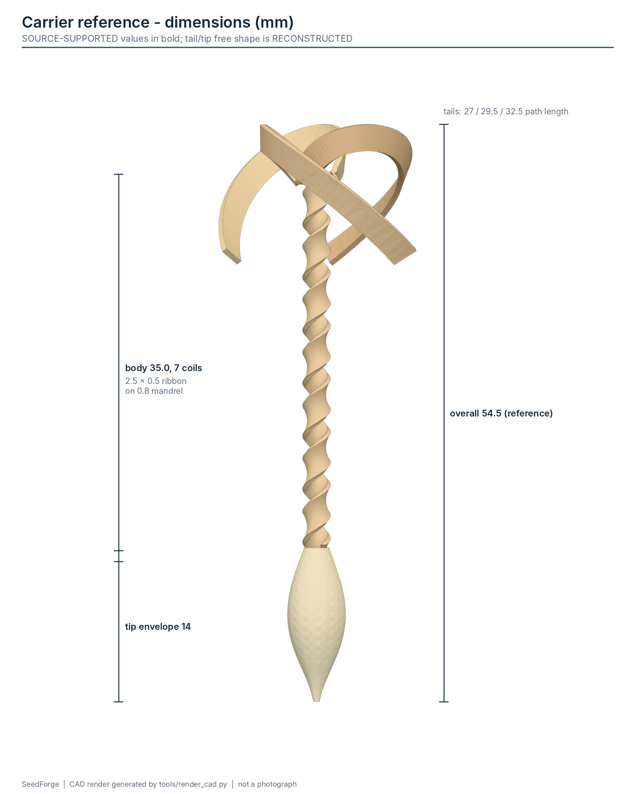

# Carrier geometry

Two related geometries live in this project. They must not be conflated.

| | Course / experimental target | Paper-inspired reference |
|---|---|---|
| Origin | EECS 149 project specification | Luo et al., *Nature* 614, 463-470 (2023) and supplementary simulation |
| Strip | 4.0 x 0.5 mm | 2.5 x 0.5 mm (published samples also used ~0.4 mm veneer) |
| Mandrel | 0.8 mm | 0.8 mm |
| Body | 7 active coils + sacrificial allowance | 7 coils over 35 mm (pitch 5.0 mm/rev), 3 tails |
| Stated angle | 45 deg nominal guide angle | not stated; 50.8 deg follows from the pitch |
| Stated condition | "no gaps, no overlap, tight winding" | coils with gaps (as modelled below) |
| Evidence level | ENGINEERING ASSUMPTION | SOURCE-SUPPORTED dimensions; RECONSTRUCTED tail/tip shape |
| Recipe file | `course_target_45deg` | `paper_reference` |

## First-order helix model

`software/seedforge/geometry.py` implements the model; `tests/geometry` checks it.

* Centre-line diameter `D = d + t`; circumference `C = pi D`.
* Strip angle from the mandrel axis `phi`: `tan(phi) = C / p`, where `p` is the axial pitch per revolution.
* Machine guide-scale angle (W12) = `90 deg - phi` (0 deg = strip square to the mandrel).
* Gap between neighbouring turns, perpendicular to the strip: `gap = C cos(phi) - w` (negative = overlap).
* A butt joint needs `cos(phi) = w / C`, which exists only when `w < C`:
  `p_butt = w C / sqrt(C^2 - w^2)`.

| case | pitch mm/rev | strip angle from axis | guide angle | predicted gap | butt-joint pitch |
|---|---|---|---|---|---|
| course target as stated (4.0 mm, 45 deg) | 4.084 | 45.0 deg | 45.0 deg | **-1.11 mm (overlap)** | 19.82 mm |
| paper reference body (2.5 mm, 7 turns / 35 mm) | 5.000 | 39.2 deg | 50.8 deg | +0.66 mm | 3.16 mm |
| 2.5 mm strip, butt joint | 3.162 | 52.3 deg | 37.7 deg | 0 | 3.16 mm |
| 4.0 mm strip, butt joint | 19.816 | 11.6 deg | 78.4 deg | 0 | (7 turns = 158 mm long) |

Run `python -m seedforge.geometry` to regenerate this table.

### What this means

* **The course specification cannot be met as written.** A 4.0 mm strip on a 0.8 mm mandrel at
  45 deg overlaps itself by about 28 % of its width in this model. "No gap and no overlap" for a 4.0 mm strip
  needs a strip almost parallel to the mandrel. A 4.0 mm strip is also about as wide as the
  centre-line circumference (4.08 mm), so it cannot lie flat and must twist or crease.
* So the machine never hard-codes 45 deg. Guide angle, pitch, tension setpoint, winding rate,
  acceleration and turn count are **recipe variables** (`SET_PITCH`, `SET_RATE`, `SET_ACCEL`, `SET_TURNS`,
  `SET_TENSION_*`; the guide angle is set on the W12 scale).
* Wet wood compresses, swells, slips and changes its effective radius. The model only gives a
  **starting point**; the accepted recipe comes from measured coils ([calibration.md](calibration.md)).

## Machine kinematics (verified in firmware tests)

* Rotation: 200 full steps x 16 microsteps = **3200 microsteps per mandrel revolution**.
* Translation: T8x8 lead screw, 200 x 16 / 8 = **400 microsteps per mm**.
* Linear microsteps per mandrel revolution = `400 p`; total for a body =
  `round(pitch_um x 400 x turns / 1000)` (for example 13069 for 4.084 mm x 8 turns).
* Synchronisation is an integer Bresenham accumulator in a timer interrupt
  ([controls.md](controls.md#motion)).

## Mandrel stiffness

A 0.8 mm steel rod is very flexible (I = 0.020 mm^4):

| lateral load | deflection, 90 mm span, pinned-pinned | fixed-pinned | peak bending stress |
|---|---|---|---|
| 0.10 N | 0.38 mm | 0.17 mm | 45 MPa |
| 0.25 N | 0.94 mm | 0.42 mm | 112 MPa |
| 0.50 N | 1.89 mm | 0.84 mm | 224 MPa |
| 1.00 N | 3.78 mm | 1.69 mm | 448 MPa |

Consequences: keep strip tension low (measure first), wind close to a support, and measure the
mandrel deflection under the real tension during Phase 1. A deflected mandrel changes the pitch the
camera sees.

## Reference CAD

| file | what it is | evidence level |
|---|---|---|
| `MR01` | 0.8 x 100 mm mandrel envelope (buy the rod) | engineering choice (100 mm is a machine convenience) |
| `MR06` | mandrel + generic chuck + depth stop | fit planning |
| `MR07` | mandrel + 7-coil body | reference |
| `PR01` | 7-coil body, 2.5 x 0.5 mm, 35 mm | SOURCE-SUPPORTED dimensions |
| `PR02-PR04` | tails, 27 / 29.5 / 32.5 mm path length | lengths SOURCE-SUPPORTED, shape RECONSTRUCTED |
| `PR05`, `PR07` | tip and fibre-clearance envelopes | RECONSTRUCTED |
| `PR08` / `PR09` | finished / exploded carrier, 1:1 | reference for fixtures and clearance only |
| `PR24` | 3x enlarged demonstration print | display model |
| `PR20-PR23` | large whitebark-pine variant (12 x 0.8 mm on 3 mm mandrel, 85 mm body, 11 mm seed) | SOURCE-SUPPORTED dimensions, tails omitted |

A 1:1 plastic print of PR08 is **not a functional seed carrier**: the real device depends on
prepared wood, its moisture response and a biodegradable tip.
