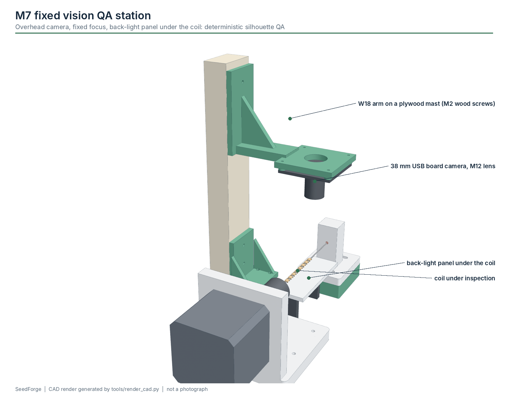
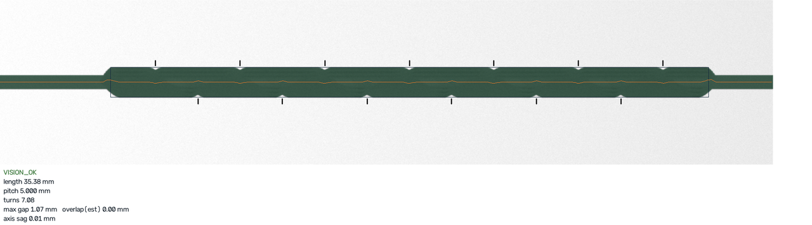
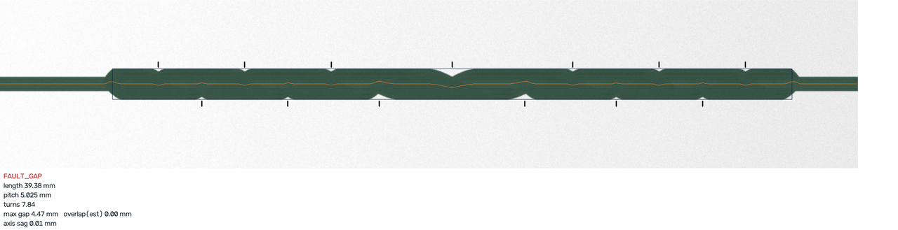
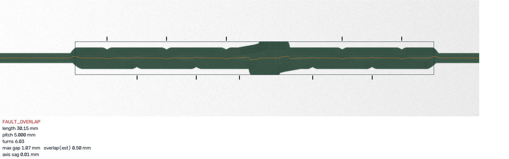

# Computer vision QA (M7)

Status: **software tested on synthetic images only.** The pipeline is deterministic (OpenCV and
NumPy, no machine learning, no cloud service). On the bundled synthetic set it gives 6 true accepts,
10 true rejects, 0 false accepts and 0 false rejects. That tests the code, **not** the method on
real wet veneer; Phase 6 requires a labelled set of real images.



## Station

* **Overhead camera:** a 38 x 38 mm USB board camera (UVC, about $15) with a manual-focus M12 lens of
  about 6 mm focal length, on the W18 arm at the top of a plywood mast, lens about 50 mm above the
  mandrel, looking straight down. Fixed focus and manual exposure; at least 40 px/mm on the coil
  needs a field of view of about 45 mm, which is why the lens is not a wide-angle one.
* **Back-light** (a 5 V white LED strip behind a 1 mm printed or paper diffuser) under the mandrel (x 36-96 mm of the core-cell layout, 20 mm above the base, covering the whole wound region). The coil is imaged as
  a dark silhouette on a bright background, which makes segmentation a simple threshold.
* Why not a side camera with a front LED ring (R3)? Reflections from wet wood vary with moisture and
  grain; a silhouette does not. A side camera would also need its back-light in the strip path
  (gap-analysis finding E7).
* Frames stay on the host. Only the verdict (`VISION_OK` / `FAULT_*`) and `LENGTH_MM` go to the Uno.

## Pipeline

`software/seedforge/vision/pipeline.py`:

1. **Checks:** empty or flat image -> `FAULT_CAMERA`.
2. **Segment** with Otsu's threshold, keep the largest connected component.
3. **Align:** principal axis (PCA) of the body, rotate it horizontal.
4. **Envelope and centre-line:** top and bottom edge per column; the coil is where the silhouette is
   taller than the bare mandrel; a quadratic fit of the centre-line gives the **axis sag** (gross
   deformation) measured from the chord.
5. **Pitch:** every turn leaves a notch in the top edge and, half a pitch later, in the bottom edge.
   Notch spacing along one edge is the local pitch; the median of all local pitches is the measured
   pitch.
6. **Gap vs overlap:** a long span between notches is either a gap (thin shell) or an overlap that
   hid a notch (double layer: the edge bulges by about one strip thickness). A bulge larger than
   0.45 x thickness classifies the span as overlap. Gaps that show background straight through the
   coil are measured directly.
7. **Turns:** visible coil length / measured pitch. At VERIFY every wound turn is still on the
   mandrel, so the host expects active + sacrificial turns (8 for `paper_reference`).
8. **Decision:** `FAULT_GAP` if the largest gap exceeds `max_gap_mm`; `FAULT_OVERLAP` if the
   estimated overlap exceeds `max_overlap_mm`; `FAULT_LENGTH` if pitch is off by more than
   `pitch_tol_frac`, turns by more than `turns_tol`, or the axis sag exceeds `max_axis_sag_mm`
   (the protocol has no separate deformation code; the reason is logged). Otherwise `VISION_OK`.





*Synthetic test images with the pipeline's overlay: detected body, centre-line, notch marks,
measured pitch, turns, gap/overlap estimate and verdict.*

### What a silhouette cannot see

* Overlap is **estimated**, not measured: a silhouette shows the outline, not the layer order.
* Twist, cracks and delamination inside the body are invisible from one view.
* Moisture, colour and surface damage are out of scope.

## Thresholds

Per recipe (`vision` block in the recipe JSON):

| key | paper_reference | meaning |
|---|---|---|
| `px_per_mm` | 40 | scale; calibrate with a target in the mandrel plane |
| `max_gap_mm` | 1.6 | largest allowed gap along the axis |
| `max_overlap_mm` | 0.4 | largest allowed estimated overlap |
| `pitch_tol_frac` | 0.15 | allowed relative pitch error |
| `turns_tol` | 0.5 | allowed turn-count error |
| `max_axis_sag_mm` | 0.5 | gross deformation limit |

These are starting values. Set real ones from Phase-1/Phase-6 data.

## Commands

```bash
python -m seedforge.vision demo --out datasets/synthetic      # build + evaluate the synthetic set
python -m seedforge.vision inspect photo.png --px-per-mm 40 --pitch 5 --turns 7 --width 2.5
python -m seedforge.vision evaluate datasets/labelled/        # confusion matrix for labelled images
python -m seedforge.host --port /dev/ttyACM0 --recipe paper_reference --vision camera:0
```

`inspect` writes `<image>_qa.png` with the overlay. `evaluate` expects `NAME.png` with `NAME.json`
containing at least `{"label": "good" | "gap" | "overlap" | "length" | "deformed"}` and writes
`report.md` / `report.json` with true/false accept/reject counts.

## Synthetic generator

`seedforge/vision/synth.py` renders back-lit silhouettes of an ideal helix from the recipe geometry
(with layer stacking for overlaps), plus labelled defects: gaps, overlaps, short coils and bent
bodies. It exists to test the code paths and the fault mapping. It is **not** a model of real wood.

## Phase-6 validation plan

1. Capture every Phase-1/2 coil with the station camera; save the raw image and the run ID.
2. Label each coil by measurement (calipers/microscope), independently of the pipeline.
3. Split into `datasets/train`, `datasets/validation`, `datasets/test` by **material lot**, not
   randomly, so the test set contains lots never used for tuning.
4. Tune thresholds on train/validation only; report the confusion matrix on test.
5. Acceptance: false accepts are the costly error; the gate is set in
   [validation.md](validation.md#phase-6-vision).

See [datasets/README.md](../datasets/README.md).
