# Controls

Firmware: `firmware/arduino/seedforge_core/` (Arduino Uno). Status: **compile-tested; hardware
testing pending.** The controller core is plain C++ behind a small hardware interface (`Hal`), so the
same code is unit-tested on a PC (`make -C tests/firmware`, 22 tests, several million checks under
AddressSanitizer/UBSan) and mirrored line-for-line by the Python simulator.

| file | content |
|---|---|
| `seedforge_core.ino` | Uno glue: Timer1 ISR, pin I/O, HX711/PCA9685/ICM-20948 drivers, EEPROM calibration, serial ports |
| `src/sf_config.h` | pins, baud rates, kinematics, limits, PCA9685 channels |
| `src/sf_motion.h/.cpp` | step generator: Bresenham synchronisation + trapezoidal ramp |
| `src/sf_protocol.h/.cpp` | line parser, fixed-point numbers, command table in PROGMEM |
| `src/sf_controller.h/.cpp` | state machine, safety checks, recipe |
| `src/sf_drivers_avr.h/.cpp` | HX711 bit-bang, PCA9685, ICM-20948 vibration RMS |

## Motion

### Kinematics

* Rotation: 200 full steps x 16 microsteps = **3200 microsteps per mandrel revolution**.
* Traverse: T8x8 lead screw, **400 microsteps per mm**.
* Linear target for a body: `lin_total = round(pitch_um x 400 x turns / 1000)`; rotation
  `rot_total = turns x 3200`, with `turns = active + sacrificial`.

### Step generation

Timer1 runs in CTC mode with prescaler 8 (0.5 us ticks); the compare value is reloaded from the
current step interval each interrupt. The ISR:

1. pulses the master axis STEP pin (direct PORTD write, about 2 us high);
2. adds the slave total to a Bresenham accumulator and, when it overflows the master total, pulses
   the slave axis in the same interrupt.

The axis with **more** steps is the master, so the slave never needs more than one step per tick
and both totals are hit exactly (an R3 problem, E3, was linear bursts above 8 mm/rev). Turn counts
are integers; there is no floating-point accumulation.

The main loop (not the ISR) updates the speed with a **trapezoidal ramp**: acceleration
`SET_ACCEL` (rev/min per s, scaled to the master axis), cruise from `SET_RATE` (rev/min), symmetric
deceleration so the motion ends at the exact step count. Limits: master axis 40-8000 microsteps/s
(`RATE_CLAMPED` is reported if a recipe asks for more). Positioning moves use 6 mm/s, homing 4 mm/s,
the demold retraction 2 mm/s.

### Why not `micros()` polling?

The R3 controller stepped from `loop()` while also sending status on SoftwareSerial, which blocks
interrupts for about half a millisecond per byte and stalled stepping. The ISR generator keeps step
**counts** exact regardless of serial traffic, but SoftwareSerial still disables interrupts for about
0.26 ms per byte at 38400 baud while sending or receiving on the link, which delays individual
steps (timing jitter, not lost steps). Traffic is therefore kept low during `WIND`: one `TURN` line
per revolution, `TENSION` every 0.5 s if enabled, `HEARTBEAT` from the host about once per second.
The USB port uses the hardware UART and does not block interrupts.

## State machine

| state | entered when | does | leaves when |
|---|---|---|---|
| BOOT | power-up, `RESET` | drivers off, status once per second | `HOME` / START button |
| HOME | `HOME`, or `START` (every cycle) | clear switch if pressed, seek at 4 mm/s, back off 2 mm, zero; re-check home error on cycles | homed -> READY or PRETENSION |
| READY | homed, no cycle pending | drivers off; accepts recipe setters, `JOG`, `TARE`, `CAL_TENSION` | `START` |
| PRETENSION | homed during a cycle | move to `SET_START`; if tension is required wait until tension >= min for 300 ms (timeout 15 s) | tension OK -> WIND |
| WIND | pretension done | synchronized move, `TURN=n` per revolution, `TENSION=` every 0.5 s | totals reached -> VERIFY |
| VERIFY | wind done | waits for the host verdict (timeout 15 s); skipped if `SET_REQUIRE_VISION=0` | `VISION_OK` -> CLAMP (M3 on) or COMPLETE |
| CLAMP | M3 enabled | CH0 to closed, 700 ms dwell | -> CUT |
| CUT | clamp done | CH1 stroke, dwell, rest, dwell; guard must stay closed | -> DEMOLD |
| DEMOLD | cut done | CH6 support closed; relative axial move `SET_DEMOLD` at 2 mm/s; support open; clamp open | -> COMPLETE |
| COMPLETE | cycle done | drivers off, `COMPLETE ...` line | `START` (next cycle), `RESET` |
| SAFE_STOP | any fault | motion stopped, drivers disabled, all PCA9685 outputs switched off (servos get no pulses, so nothing moves when power returns), position forgotten | `RESET` when the rail is back (E-stop released) and tension is below the trip |

`SAFE_STOP` requires a deliberate `RESET`; after it the machine is in BOOT and must home again.
`RESET` never moves anything.

### The START button

| state | press means |
|---|---|
| BOOT | home |
| READY / COMPLETE | start a cycle |
| any moving state | stop (`LOCAL_STOP`) |
| SAFE_STOP | reset (still needs the E-stop released) |

### Safety stop conditions

Checked every loop iteration (about every millisecond), before the state logic:

| fault | condition |
|---|---|
| `ESTOP_OPEN` | switched 12 V rail absent on D8: E-stop pressed, motor fuse blown, adapter off or sense wire broken (any state) |
| `LIMIT_WIRING` | home and end both read actuated (broken common wire) |
| `END_LIMIT` | end switch while moving toward it |
| `HOME_LIMIT` | home switch while moving toward it outside homing, or switch stuck after clearing/backing off |
| `SOFT_LIMIT` | carriage beyond 100 mm from home |
| `HOME_TIMEOUT` | home switch not found within travel + 20 mm |
| `SKIPPED_STEPS` | home re-check error > 0.3 mm twice without a good re-check in between (the first one gives `ERROR=HOME_DRIFT`) |
| `TENSION_HIGH` | two consecutive raw HX711 samples above `SET_TENSION_MAX` (counted continuously), tripping in PRETENSION ... DEMOLD |
| `LOADCELL` | tension required and no fresh sample for 500 ms (PRETENSION/WIND) |
| `PRETENSION_TIMEOUT` | minimum tension not reached in 15 s |
| `HEARTBEAT_TIMEOUT` | vision required and no `HEARTBEAT` for `SET_HEARTBEAT_MS` (default 3 s) in WIND/VERIFY |
| `VISION_TIMEOUT` | no verdict 15 s after entering VERIFY |
| `VISION_GAP` / `_OVERLAP` / `_LENGTH` / `_TAIL` / `_CAMERA` | host sent the matching `FAULT_*` |
| `COMM_ERRORS` | 5 malformed lines within 2 s while moving |
| `GUARD_OPEN` | cutter guard open during CUT (if fitted) |
| `VIBRATION` | IMU RMS above the trip level (disabled until characterised) |
| `REMOTE_STOP` | `STOP` or `EMERGENCY_STOP` command |
| `LOCAL_STOP` | START pressed while moving |

Stop and fault commands are honoured in **every** state, including while paused (the original EECS
149 sketch ignored `EMERGENCY_STOP` while paused).

## Tension

The HX711 is read without blocking whenever a sample is ready. The trip uses **raw samples**, two in
a row, so no filter delays it. A proportional speed trim (slow down when tension rises above the
setpoint) exists in the code but its gain is **0** until the wet-veneer tension window has been
measured; enabling it before then could hide a jam. `PRETENSION` waits for `SET_TENSION_MIN`.
Calibration (`TARE`, `CAL_TENSION=<N>`) is stored in EEPROM; the load cell counts as valid only
after a `CAL_TENSION`, never after `TARE` alone.

## Vibration (ICM-20948)

Machine health only, never a tension sensor. The driver computes
`a_RMS = sqrt(sum((|a_i| - mean|a|)^2) / N)` over a short window in milli-g. Derating (`VIB_DERATE_MG`)
and tripping (`VIB_TRIP_MG`) are compiled in but set to 0 (off) until a baseline is measured on the
built machine. No vibration PID is claimed. The current value is reported as `vib_mg=` in every `STATUS` line
(send `STATUS` during a dry run to record a baseline), together with the raw dancer position
`dancer=` from A0 (reported only; not used for control).

## Watchdogs and failure of other layers

* **Host disappears**: no `HEARTBEAT` -> `HEARTBEAT_TIMEOUT` in WIND/VERIFY; no verdict ->
  `VISION_TIMEOUT`.
* **ESP32 disappears**: the bridge never generates heartbeats, so the same watchdog trips.
* **Uno resets**: the ENABLE pull-up disables the drivers during reset; the Uno restarts in BOOT
  and must be homed.
* **Garbage on the link**: malformed or overlong lines get `ERROR=BAD_COMMAND`; five in two seconds
  while moving stop the machine. An overlong line is discarded whole.
* **Vision not required** (`SET_REQUIRE_VISION=0`): there is no heartbeat watchdog. Use it only for
  supervised dry runs.

## Recipe variables

Defaults are **commissioning values, not validated**:

| command | default | range | meaning |
|---|---|---|---|
| `SET_PITCH` | 4.084 | 0.2-30 mm/rev | axial pitch per revolution (default = the inconsistent 45 deg course case, finding C2) |
| `SET_TURNS` | 7 | 1-40 | active turns |
| `SET_SACRIFICIAL` | 1 | 0-5 | extra turns for clamping/handling |
| `SET_RATE` | 30.0 | 1.0-300.0 rev/min accepted | mandrel cruise speed; capped at 150 rev/min by the 8 kHz master step rate (`RATE_CLAMPED`) |
| `SET_ACCEL` | 30.0 | 1.0-3000.0 rev/min/s | ramp |
| `SET_START` | 5.00 | 0-100 mm | carriage start, mm from home |
| `SET_TENSION` | 0 | 0-9.8 N | setpoint (trim reference) |
| `SET_TENSION_MAX` | 0 (off) | 0-9.8 N | hard trip |
| `SET_TENSION_MIN` | 0 | 0-9.8 N | pretension acceptance |
| `SET_REQUIRE_TENSION` | 0 | 0/1 | refuse to run without a calibrated, configured load cell |
| `SET_REQUIRE_VISION` | 1 | 0/1 | wait for a verdict in VERIFY and enforce heartbeats |
| `SET_M3` | 0 | 0/1 | run CLAMP/CUT/DEMOLD |
| `SET_DEMOLD` | 20.00 | -100...100 mm | relative retraction during DEMOLD |
| `SET_HEARTBEAT_MS` | 3000 | 200-60000 | heartbeat timeout |
| `SET_DIR` | 0 | 0-3 | bit 0 invert rotation, bit 1 invert linear |

Before every cycle the controller checks that start + pitch x turns (+ demold) stays inside the
100 mm travel, and refuses with `ERROR=RECIPE_TRAVEL` otherwise. The host-side checker
(`python -m seedforge.host --check-recipe`) adds the CAD-derived carriage windows, mandrel free span
and the geometry model's overlap warnings.

## Memory budget

Uno build (arduino-cli, Arduino AVR core): about 28.3 kB flash (87 %), 1.0 kB static RAM (50 %).
Strings live in PROGMEM. Adding features may need trimming elsewhere.

## Simulator

`software/seedforge/simulator/core.py` is a line-by-line Python port of `sf_controller.cpp` and
`sf_motion.cpp`; `tests/host/test_sim_parity.py` compiles the C++ core and checks that both produce
byte-identical traces for every scenario. See [simulator.md](simulator.md).
