# Optional aerial deployment concept (M10)

> **Conceptual deployment architecture.** Nothing on this page has been built, flown or tested.
> It is downstream of manufacturing (Phase 8) and only makes sense after Phases 0-7 pass. Do not
> start here.

## Principles

1. **Use a proven aircraft.** An existing ArduPilot-compatible multirotor with its own certified or
   well-established flight stack. SeedForge does not design airframes, propulsion or flight control.
2. **Separate the jobs.**
   * The **flight controller** flies (stabilisation, navigation, geofence, failsafes) and, in the
     budget design, signals the payload controller at each waypoint.
   * An optional **companion computer** may classify terrain from a downward camera and request
     releases. It never drives propulsion motors.
   * An independent **payload controller** owns the release gates and fails closed.
3. **One carrier, one point, one record.** Each planting point has a unique ID inside exactly one
   pre-assigned, non-overlapping sector. Release intent is logged **before** a gate opens; the
   release is confirmed afterwards.
4. **Never auto-retry uncertain points.** If a release cannot be confirmed, the point is marked
   UNCERTAIN and left for a human. Retrying automatically risks duplicate planting.

## Architecture (budget)

| block | budget hardware | responsibility |
|---|---|---|
| aircraft | any ArduPilot multirotor you already have, or the budget quad in BOM view C: ArduPilot-supported F405 FC + 4-in-1 ESC stack, F450-class frame, 2212 motors, 1045 props, M10 GPS/compass, 3S 2200 mAh | flight, geofence, return-to-launch, mission waypoints |
| RC and telemetry | ELRS receiver + transmitter (often owned); MAVLink over ELRS | pilot override; no separate telemetry radio |
| ground coordinator | laptop with Mission Planner or QGroundControl | sector plan, unique point IDs, permissions record |
| payload controller | Raspberry Pi Pico / RP2040-Zero (about $4) | receives "release point N" from a flight-controller servo/relay output at the waypoint; logs INTENT to flash, opens one door, confirms with the cell's IR sensor, logs RELEASED or UNCERTAIN; fails closed |
| release confirmation | TCRT5000 IR reflective sensor per cell (about $0.40 each) | cell empty after the door opened = released |
| cassette | D01 four-cell cassette, D02 doors, D03 servo mounts (SG90, M2), D04 rail adapter | one carrier per cell |
| companion computer (optional) | Raspberry Pi Zero 2 W + camera (D05, D06) | only for terrain classification; pre-planned points do not need it |

Cost (planning estimates, BOM view C): **payload kit about $18** if an ArduPilot aircraft is already
available; **about $154** with the budget quad if you own a balance charger and an ELRS radio
(about $224 buying those too). The R3.1 draft priced a Pixhawk-class aircraft with a 4S battery,
separate telemetry radio and companion computer at about $451.

Budget trade-offs: an F405 board has less redundancy than a Pixhawk-class controller; check that the
exact board is on ArduPilot's supported list before buying, and keep the mass, centre-of-gravity and
thrust-margin check below. Cheapness never justifies flying a payload without the permissions.

The printed D-parts are concept geometry for bench tests (fit, door actuation, release
repeatability). The D04 rail adapter is **not** a structural or flight-rated mount.

## Swarm concept

The website animation shows Drone A -> Sector A, Drone B -> Sector B, Drone C -> Sector C, each
completing unique points. It is labelled *Conceptual deployment architecture*. No autonomous swarm
has been field-validated, and sectors exist precisely so that coordination failures cannot cause two
aircraft to plant the same point.

## Ledger (software concept)

`software/seedforge/deploy/ledger.py` implements the bookkeeping rules and is unit-tested
(`tests/host/test_ledger.py`):

| state | meaning |
|---|---|
| PLANNED | point assigned to a sector |
| INTENT | release intent persisted (atomic file write) before the gate is commanded |
| RELEASED | release confirmed |
| UNCERTAIN | gate commanded but confirmation missing, or the system restarted with the point in INTENT |
| SKIPPED | rejected site (terrain, permission, safety) |

A drone can only claim points in its own sector; `recover_after_restart` turns every INTENT into
UNCERTAIN; nothing moves out of UNCERTAIN without a human.

## Gate to start Phase 8 bench work

* Manufacturing Phases 0-7 met and documented.
* Bench release tests: door actuation and single-carrier release repeatability on the bench, no
  aircraft.
* Mass, centre-of-gravity and thrust-margin calculation for the chosen aircraft with the payload.
* Written landowner permission and ecological review for any test site; native species only.
* Aviation compliance for the jurisdiction (pilot certification, operational waivers or
  authorisations for dropping objects, airspace permission) **before** any flight with a payload.

See [safety.md](safety.md#aerial-deployment).
