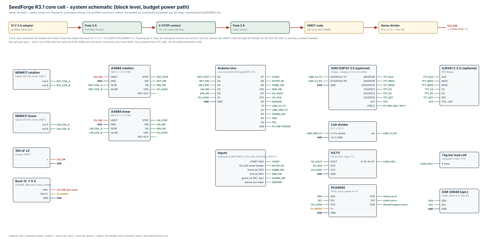
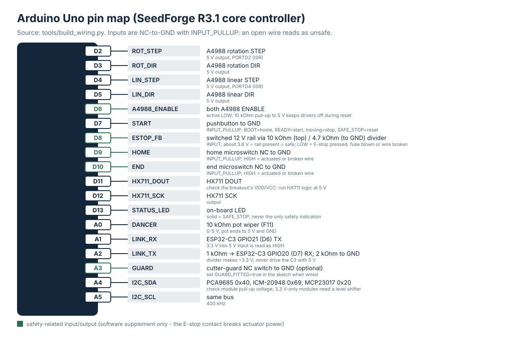

# Electronics

Research-prototype wiring. It is **not** certified machinery safety and must not be presented as
such. Status: schedule generated and cross-checked against the firmware pin constants;
**hardware testing pending**.

| document | content |
|---|---|
| [hardware/electronics/seedforge_core_schematic.svg](../hardware/electronics/seedforge_core_schematic.svg) | system schematic (block level, every conductor named, budget power path) |
| [hardware/wiring/WIRING.md](../hardware/wiring/WIRING.md) | pin map + point-to-point table (generated) |
| [hardware/wiring/pin_map.csv](../hardware/wiring/pin_map.csv), [connection_table.csv](../hardware/wiring/connection_table.csv) | the same, machine-readable |
| [diagrams/D_arduino_pin_map.svg](diagrams/D_arduino_pin_map.svg) | Uno pin map figure |
| [diagrams/C_power_tree.svg](diagrams/C_power_tree.svg) | power tree |
| [diagrams/G_safety_chain.svg](diagrams/G_safety_chain.svg) | safety chain |

Regenerate the schedule with `python tools/build_wiring.py` and the schematic with
`python tools/build_schematic.py`.

## Hierarchy

Host (vision, logging) <-> XIAO ESP32-C3 (bridge, display) <-> Arduino Uno (real-time core) ->
A4988 drivers, HX711, PCA9685, limit switches. The Uno also accepts the same protocol directly on
its USB port, so Phase 1 can run without the ESP32 at all.

## Power tree

| rail | source | feeds | protection |
|---|---|---|---|
| 12 V | certified 12 V 3 A adapter, barrel jack | E-stop NC contact | 3 A fuse directly after the jack |
| 12 V_SW (switched) | E-stop contact | A4988 VMOT x2 (100 uF each) via a 2 A fuse; LM2596 buck | 2 A fuse on the motor branch |
| E-stop sense | VMOT node through 10 k / 4.7 k | Uno D8 (about 3.8 V = rail present) | divider limits current to < 1 mA |
| 5 V_SERVO | LM2596 buck 12 -> 5 V (set 5.0 V with a meter first) | PCA9685 V+, servos, LED back-light, ULN2003 boards | switched by the E-stop (upstream) |
| 5 V_LOGIC | Uno USB | Uno, A4988 VDD, HX711, I2C module logic | PC USB port |
| 3.3 V (optional) | XIAO USB-C | XIAO, ILI9341 | PC USB port |

Budget choice: R3.1 drew a 65 W USB-C PD supply, a PD trigger and a 20 -> 12 V buck. A certified 12 V
3 A wall adapter does the same job for this load (two NEMA17s at <= 1 A per phase through A4988
choppers plus three micro servos on the separate 5 V buck) at about a third of the cost.

Rules:

* **Star ground**: one lever connector; jack negative, the buck, the Uno (and the optional XIAO) join
  it once. Do not daisy-chain grounds through the drivers.
* **Never parallel** USB supply outputs; never back-feed the Uno 5 V pin or the XIAO 5 V pin from a
  buck while it is also on USB.
* **At least 100 uF**, 35 V or higher, at each A4988 VMOT, with short leads.
* Check the adapter polarity (centre positive) and the LM2596 output with a meter before connecting
  anything; LM2596 modules usually ship set far from 5 V.
* Servos never run from the Uno 5 V pin (stall currents reset the Uno).

## Connector policy

| connection | connector | why |
|---|---|---|
| stepper phases (12 V_SW) | keyed 4-pin JST-XH (or screw terminals) | **never USB-C**: a motor lead must not fit a computer port |
| 12 V power | lever connectors (tinned or ferruled ends) | no loose strands; easy to inspect |
| limit switches, START, E-stop sense | 2-pin JST-XH or Dupont with latch | NC switches and the rail sense both read "unsafe" when a connector is pulled |
| HX711 to load cell | 4-pin JST, short twisted leads | low-level analog signal |
| I2C modules | Qwiic/STEMMA QT or 4-pin JST | keep under about 30 cm |
| Uno <-> XIAO link | 3-pin JST (TX, RX via divider, GND) | divider lives on the Uno side |
| servos | standard 3-pin servo headers on the PCA9685 | servo power on the PCA9685 V+ screw terminal |

Never plug or unplug a stepper while VMOT is live.

## Uno pin map

| pin | signal | direction | notes |
|---|---|---|---|
| D2 | ROT_STEP | out | driven from the Timer1 ISR (PORTD bit 2) |
| D3 | ROT_DIR | out | |
| D4 | LIN_STEP | out | ISR, PORTD bit 4 |
| D5 | LIN_DIR | out | |
| D6 | A4988 ENABLE | out | shared, active LOW, 10 k pull-up keeps drivers off during reset/upload |
| D7 | START | in, pull-up | press = home / start / stop / reset depending on state |
| D8 | ESTOP_FB | in | E-stop rail sense: VMOT node via 10 k / 4.7 k divider; HIGH (about 3.8 V) = rail present = safe (`ESTOP_SENSE_RAIL = true`; set `false` for the R3.1 auxiliary-contact wiring) |
| D9 | HOME | in, pull-up | NC microswitch to GND; open = actuated or broken wire |
| D10 | END | in, pull-up | same |
| D11 / D12 | HX711 DOUT / SCK | in / out | 80 Hz mode recommended (RATE pin high) if the breakout exposes it |
| D13 | status LED | out | solid in SAFE_STOP; never the only indication |
| A0 | dancer pot | analog in | 0-5 V |
| A1 / A2 | link RX / TX (SoftwareSerial 38400) | in / out | A2 through 1 k series, 2 k to GND |
| A3 | cutter guard | in, pull-up | optional; set `GUARD_FITTED` in the sketch |
| A4 / A5 | I2C SDA / SCL | - | PCA9685 0x40, ICM-20948 0x69, MCP23017 0x20 |

PCA9685 channels: CH0 clamp, CH1 cutter, CH2 tail sweep, CH3 tail clamp, CH4 transfer gripper,
CH5 transfer Z, CH6 demold support. Slow auxiliaries (seed indexer, syringe) use MCP23017 ->
ULN2003 -> 28BYJ-48; never use 28BYJ-48 motors for synchronized winding.

### Logic-level notes

* The XIAO ESP32-C3 is a 3.3 V part and **not 5 V tolerant**: the Uno's A2 output goes through the
  1 k / 2 k divider (about 3.3 V). The XIAO's 3.3 V TX into the Uno A1 reads reliably as HIGH.
* Many ICM-20948 breakouts are 3.3 V-only, with pull-ups to 3.3 V. On the Uno's 5 V I2C bus use a
  breakout whose documentation confirms 5 V-safe I2C, or add a bidirectional level shifter.
  *Check your breakout's schematic before connecting.*
* HX711 breakouts with separate VDD/VCC: run the logic side at 5 V to match the Uno.

## Safety circuit concept

1. A latching mushroom E-stop with **one NC contact** rated for the DC load (at least 12 V DC, 3 A;
   check the DC rating, AC ratings do not apply).
2. The contact sits in the 12 V actuator rail between the 3 A fuse and everything that moves: both
   A4988 VMOT (through the 2 A fuse) and the servo buck. Pressing it removes motor and servo power
   regardless of firmware state.
3. **Rail sensing instead of an auxiliary contact (budget wiring).** A 10 k / 4.7 k divider from the
   VMOT node to Uno D8 gives about 3.8 V while the rail is live. When the E-stop is pressed, the motor
   fuse blows, the adapter is unplugged or the sense wire breaks, D8 reads LOW; the Uno disables
   the drivers, enters `SAFE_STOP` with `FAULT=ESTOP_OPEN` and refuses `RESET` until the rail is back.
   This needs a cheaper single-contact E-stop and also catches faults an auxiliary contact cannot.
   (Wiring with an auxiliary NC contact to GND still works: set `ESTOP_SENSE_RAIL = false`.)
4. Logic stays powered so the display and log can show what happened.
5. Releasing the E-stop does **not** restart anything: the firmware has already disabled the
   drivers and switched every PCA9685 output off; `RESET` (or START) followed by homing is required.

Limitations: there is no safety relay, no monitored redundancy and no rated stop category. Software
trips (limits, tension, heartbeat, vision) are supplementary. Keep hands out of the winding area
while the drivers are enabled; add a guard before Phase 2.

## Bridge (XIAO ESP32-C3)

| XIAO pin | GPIO | use |
|---|---|---|
| D6 | 21 | link TX -> Uno A1 |
| D7 | 20 | link RX <- Uno A2 (divided) |
| D8, D9, D10 | 8, 9, 10 | ILI9341 SCK, MISO, MOSI |
| D1, D2, D3 | 3, 4, 5 | ILI9341 CS, DC, RST |

GPIO8 and GPIO9 are strapping pins; the display lines do not hold them low at reset, but do not
press the BOOT button while connecting the display.
