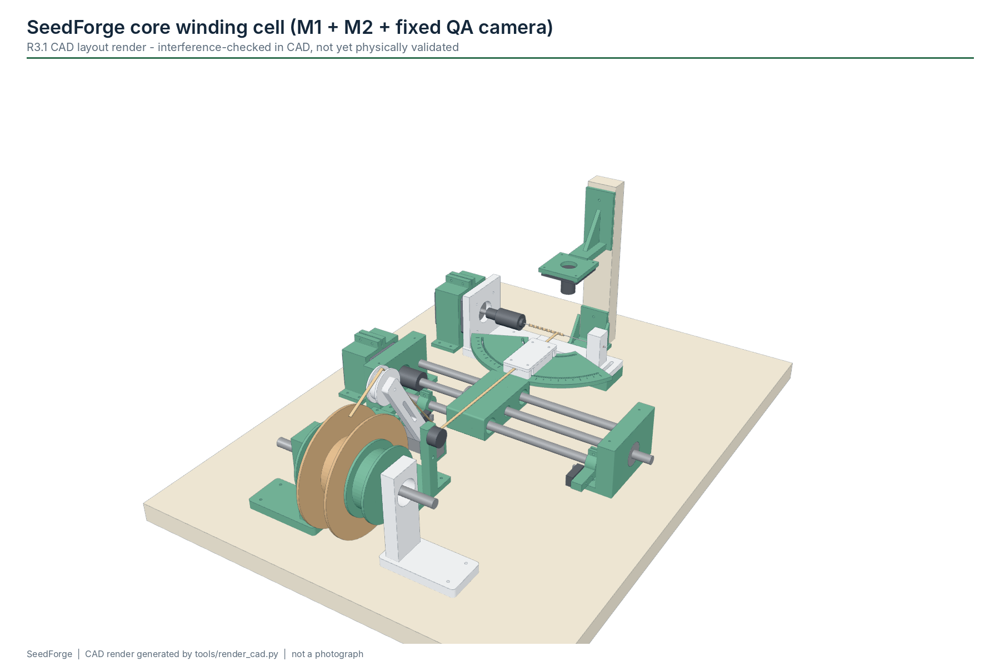
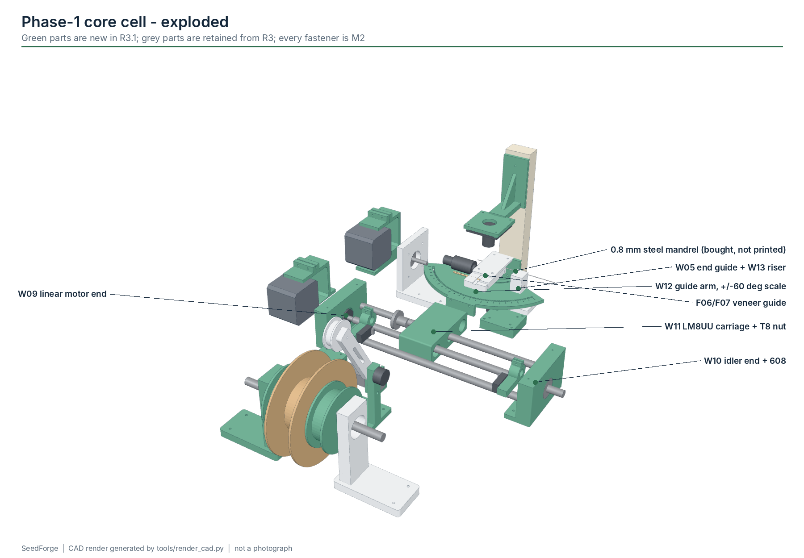

# Getting started: building the Phase-1 core winding cell

This guide is for a motivated engineering student who has never seen SeedForge before. It walks
through the **first build target**: one automated core-winding cell (M1 feed/tension, M2
synchronized winder and a fixed camera), followed by M3 clamp/cut/demold in Phase 2.

> **Status of this guide.** Written from CAD, datasheets and the firmware, **before** anyone built
> this revision. Every step marked *Measure before final fabrication* depends on purchased-part
> dimensions that vary between suppliers. Expect to iterate, and please report what you find
> ([CONTRIBUTING.md](../CONTRIBUTING.md)).

Read [safety.md](safety.md) first. The machine has rotating shafts, pinch points and, from Phase 2,
a cutter.

---

## 1. What am I building?



A bench machine about 380 x 507 mm that pulls a thin wet wood strip off a spool, measures its
tension, and winds it onto a 0.8 mm steel rod (the *mandrel*) as a tight helix: the body of a
self-burying seed carrier. Two stepper motors do the work:

* the **rotation** motor spins the mandrel in a mini drill chuck;
* the **traverse** motor moves a carriage along a lead screw, carrying the strip guide, so each
  turn of the mandrel lays the strip one *pitch* further along.

An Arduino Uno keeps the two motors exactly in step (an integer Bresenham algorithm in a timer
interrupt), watches the limit switches, load cell and E-stop, and runs the state machine. An optional
ESP32-C3 shows status and links to a laptop over USB, BLE or Wi-Fi. The laptop runs the camera
check and keeps the run log.


What you are **not** building yet: tail forming, drying fixtures, seed/tip assembly, transfer
robots or anything that flies. Those come after Phase 1 and 2 pass their gates
([validation.md](validation.md)).

Background you should read once: [carrier-geometry.md](carrier-geometry.md) (why pitch and guide
angle are recipe variables), [system-overview.md](system-overview.md).

## 2. What should I buy first?

Buy in two rounds so you learn before spending the rest.

This is the **budget build**: generic parts, one M2 fastener kit, a 12 V wall adapter instead of a
USB-C PD supply, a USB board camera instead of a depth camera. The whole view-A list is about
**$128** if you already own an Uno, two NEMA17s and two A4988s, or about **$153** buying everything
(planning estimates, [BOM.md](../hardware/bom/BOM.md)).

> **One fastener size: M2.** Every screw on the machine is a 2 mm metric (M2) screw: M2 machine
> screws with nuts/washers, M2 thread-forming screws into 1.8 mm printed pilots, and M2.2 wood
> screws into the plywood. ("M2" here is the screw size, not module M2.) The NEMA17s' own M3 face
> threads and the load cell's M4/M5 threads are not used: the W15/W16 clamps hold the motors by their
> bodies and F08 + F13 clamp the load cell. The only other threads are parts' built-in ones (chuck
> and coupler grub screws, pot nut) and motion screws (the T8 lead screw).

**Round 1 - prove the motion (about $75 of parts if you already own an Uno, motors and A4988s):**

| BOM id | item | why first |
|---|---|---|
| A01, A03, A05 | Arduino Uno, 2 x A4988, 2 x NEMA17 | the motion system |
| A04 | 2 x 100 uF capacitors | protect the drivers |
| A06, A07, A08, A09 | T8x8 screw + nut, 2 x 8 mm rods, 2 x LM8UU, 5-8 mm coupler | traverse axis |
| A10 | 608ZZ bearings | screw end, spool |
| A11, A12, A13 | mini drill chuck on 5 mm arbor, 0.8 mm mandrel rods, PTFE tube | rotation train |
| A14 | 2 x lever microswitch | homing and end limit |
| A20-A27 | 12 V 3 A adapter, barrel jack, LM2596 buck, E-stop (1 NC contact), fuses, wire, keyed motor connectors | power and safety: never run motors without them |
| A28 | START button, resistor assortment | inputs and the E-stop sense divider |
| A36, A37, A38 | plywood, the M2 fastener kit, 1 kg PETG | frame and prints |

**Round 2 - add sensing and vision (about $30):** A15 load cell + HX711, A16 MR62ZZ bearings, A17 pot,
A18 spool axle, A19 felt/rubber/PTFE consumables, A29 USB board camera, A30 LED-strip back-light.
The camera mast is a strip cut from the plywood offcut.

**Phase 2 (M3, about $16):** A31 servos, A32 PCA9685, A33 flush cutter.

**Optional:** A02 XIAO ESP32-C3 + A35 display (USB to the Uno does the same job), A34 IMU.

Full list with specs and estimates: [hardware/bom/BOM.md](../hardware/bom/BOM.md).

## 3. What should I print first?

Print the **fit coupon first** and tune hole sizes before anything else:

1. `Z01_fit_calibration_coupon` - checks the M2 clearance (2.4) and pilot sizes, the 8.2 mm rod bore, the 15.2 mm
   LM8UU bore and the 22.2 mm 608 pocket on *your* printer. If a test bore is too tight or loose,
   adjust the printer's hole compensation (or the parameter in
   `hardware/cad/source/core_cell.py`) instead of drilling every part.

Then the Phase-1 set, in this order (STEP, STL and 3MF in `hardware/cad/`; release download
`SeedForge_v0.3.0-alpha_PHASE1_PRINTS.zip`):

| order | parts | module |
|---|---|---|
| 1 | W01, W15, W13, W05 | rotation train (37.0 mm axis datum, motor body clamp) |
| 2 | W09, W16, W10, W11, W14 x2 | traverse axis |
| 3 | W12, F06, F07 | angle-adjustable guide |
| 4 | F09, F02, F10 x2, F11, F04, F05 x2, F08, F13, F12 | feed and tension |
| 5 | W17, W18 | camera mast foot and camera arm |
| 6 | C02 x10, C03, C04 (C05 only with the optional display) | cable clips, electronics box |

Printer settings (Bambu Lab A1 Mini or similar 180 mm printer): PETG, 0.4 mm nozzle, 0.16-0.20 mm
layers; 4-5 walls and 40-50 % infill for W01/W09/W10/W11 (motor and bearing loads), 3 walls and
25-35 % gyroid infill elsewhere (full table in the CAD README).
PLA is acceptable for fit tests only. Orientation notes are in each part's `notes` field in
[printed_parts.csv](../hardware/bom/printed_parts.csv). Details: [hardware/cad/README.md](../hardware/cad/README.md).

Do **not** print: the mandrel (buy steel wire), a cutter blade (buy a flush cutter), or the superseded
parts W03, W04, F01, F03, W06, Q03.

## 4. What tools are required?

* Digital calipers (0.01 mm), steel rule, square.
* Multimeter with continuity beep (mandatory for E-stop and coil checks).
* Small Phillips driver and a 1.5 mm hex key (M2 screws), small pliers or a 4 mm nut driver for M2 nuts.
* Drill with a 1.5 mm bit (pilot holes for M2.2 wood screws in plywood) and a 2.5 mm bit; countersink.
* Soldering iron, wire strippers, ferrule crimper, JST-XH crimper (or use screw terminals).
* No heat-set inserts needed: M2 thread-forming screws cut their own thread in the 1.8 mm pilots.
* Fine side cutters and a deburring tool for the mandrel rod.
* A set of known masses (for example 50 g, 100 g, 200 g) for load-cell calibration.
* Safety glasses.

## 5. How do I assemble the core winder?



Coordinates below are from the R3.1 layout (`hardware/cad/source/core_cell_layout.json`): x runs
along the mandrel away from the chuck, y towards the feed (negative) and the camera (positive), z up
from the plywood. Print the drilling template `hardware/drawings/core_cell_drilling_template.svg`
at 100 % (check its 100 mm scale bar), tape it to the plywood and centre-punch the holes.

1. **Base.** Cut 18 mm plywood to about 380 x 507 mm. Drill from the template.
2. **Rotation train.** Screw W01 and the W15 body clamp to the base (M2 wood screws). Slide the
   NEMA17 into W15 from behind until its 22 mm boss sits in W01's hole, then tighten the two M2
   pinch screws across the W15 slit (axis 37.0 mm above the base). The motor's M3 face holes stay
   empty. Fit the chuck's 5 mm arbor on the motor shaft. *Measure before final fabrication:* chuck length
   and runout - spin it by hand with a dial indicator or a rod and a fixed pointer.
3. **Mandrel support.** Fit a short PTFE tube in W05's bore. Mount W05 on the W13 11 mm riser
   (this corrects R3's axis-height mismatch, finding G1) at x = 104 mm.
4. **Mandrel.** Cut 0.8 mm rod to 100 mm, deburr both ends, check straightness by rolling it on
   glass. Insert about 8 mm into the chuck, pass the far end through the PTFE bushing and tighten.
   It should spin freely by hand without visible wobble.
5. **Traverse axis.** Press the two 8 mm rods into W09 (motor end) and W10 (idler end), 56 mm
   apart, with W11 and its LM8UU bearings on the rods; lock the rods with M2 set screws. Fit the T8
   nut to W11 with 4 x M2 thread-forming screws through its 3.5 mm flange holes (16 mm PCD;
   *measure your nut*). Hold the linear NEMA17 in the W16 body clamp with its boss in W09's hole.
   Couple the motor to the screw with the 5-8 mm coupler, support the far end
   in W10's 608ZZ. The axis lies parallel to the mandrel at y = -127 mm. Slide the carriage by hand
   end to end: it must not bind anywhere. If it does, loosen W10, slide it to self-align, retighten.
6. **Limit switches.** Clamp W14 on the rear rod with the home switch tripping when the carriage is
   at x = 45 mm and the end switch at x = 149 mm. Wire both **normally closed** to GND.
7. **Guide.** Bolt W12 to the carriage, then F06 (with a PTFE-tape lining) and F07 to the W12 arm.
   The W12 arc slots allow -60 to +60 deg about the contact point; the scale has 5 deg marks.
   *Measure before final fabrication:* the strip height in F06 (inferred from CAD, gap-analysis
   open item).
8. **Feed.** Assemble the spool stands F09 + F02 with 608ZZ bearings, the 8 mm axle and F10 hubs;
   felt washers give adjustable drag. Mount the 10 k pot in F11 with F04/F05 as the dancer and a
   light spring. Lay the load cell's fixed end in the F08 channel and clamp it with the F13 cap
   (4 x M2). Slide F12 over the free end, lock it with one M2 screw, and fit two MR62ZZ bearings
   on an M2 x 16 screw axle between its cheeks: that is the sensing roller.
9. **Camera.** Mount the back-light panel on its 20 mm standoffs under the mandrel (x 36-96 mm, the panel passes under the open front of W05) and the
   USB board camera under the W18 arm (4 x M2), about 50 mm above the mandrel, lens down. The mast is
   a 30 x 18 x 175 mm strip of the plywood offcut, held by W17 at x = 70 mm behind the mandrel.
10. **Electronics.** Mount the Uno, A4988s, LM2596 buck and lever connectors in C03 with M2
    screws, nuts and washers (the Uno's 3.2 mm holes take M2 + washer); motor power and logic
    wiring on opposite sides.

Collision check: the layout was swept for guide angles -60...+60 deg. The carriage is collision-free
from x = 45-150 mm for -45...+45 deg, but only 60-120 mm at -60 deg and 85-150 mm at +60 deg. The
recipe checker (`python -m seedforge.host --check-recipe ...`) warns when a recipe leaves the window.

## 6. How do I wire it?


Use the generated schedule: [hardware/wiring/WIRING.md](../hardware/wiring/WIRING.md) (pin map and
point-to-point table) and [electronics.md](electronics.md) (schematic, connector policy, safety
circuit). In short:

* **Power:** certified 12 V 3 A adapter -> barrel jack -> 3 A fuse -> **E-stop NC contact** -> 2 A fuse
  -> both A4988 VMOT (100 uF at each), and E-stop -> LM2596 buck set to 5.0 V -> servo rail.
  The Uno runs from USB.
* **E-stop sense:** a 10 k / 4.7 k divider from the VMOT node to Uno D8 (about 3.8 V while the rail is
  live). The Uno sees the rail disappear whatever the cause: E-stop, blown fuse, unplugged adapter.
* **Star ground** at one lever connector; the Uno ground joins it once.
* **Motors** on keyed JST-XH or screw terminals. Never USB-C connectors for motor phases.
* **Uno pins:** D2/D3 rotation STEP/DIR, D4/D5 linear STEP/DIR, D6 shared ENABLE (10 k pull-up to
  5 V), D7 START, D8 E-stop rail sense, D9/D10 home/end, D11/D12 HX711, A0 dancer,
  A1/A2 link to the optional XIAO (A2 through a 1 k / 2 k divider), A4/A5 I2C.
* **A4988 MS1, MS2, MS3 to 5 V** (1/16 step). RESET tied to SLEEP.

Check every connection with the multimeter **before** applying power, then power up without motors
connected and check that 12 V appears at VMOT only when the E-stop is released, that D8 reads about
3.8 V then and 0 V with the E-stop pressed, and that the LM2596 output is 5.0 V before any servo is
plugged in.

## 7. How do I set A4988 current safely?

The A4988 limits coil current to `I_max = Vref / (8 x Rs)`, so `Vref = I_max x 8 x Rs`, where `Rs`
is the current-sense resistor on **your** board:

| board | Rs (read the resistor marking) | Vref for 1.0 A | Vref for 0.8 A |
|---|---|---|---|
| Pololu #1182 (current revision, R068) | 0.068 ohm | 0.54 V | 0.44 V |
| many generic red modules (R100) | 0.100 ohm | 0.80 V | 0.64 V |
| older boards marked R050 | 0.050 ohm | 0.40 V | 0.32 V |

Procedure:

1. Motors **disconnected**. Logic power (5 V) and VMOT (12 V) on.
2. Measure between GND and the potentiometer's metal wiper (or the Vref test point).
3. Turn the pot with a ceramic or insulated screwdriver until Vref matches the table.
4. Start at **0.8-1.0 A** even if the motor is rated 1.5-1.7 A: the loads here are tiny, and lower
   current means less heat and less risk. Raise it only if the motor stalls.
5. Fit heatsinks. Never connect or disconnect a motor while VMOT is on; that can destroy the driver.

Check the datasheet of your exact module: some clones use different resistors or route Vref
differently.

## 8. How do I identify stepper coil pairs?

A NEMA17 has two coils (A and B), four wires. Wire colours are **not** standard.

1. Disconnect the motor. Set the multimeter to resistance or continuity.
2. Measure between wire pairs. Two wires belonging to the same coil read a few ohms (typically
   1.5-4 ohm); wires from different coils read open.
3. Label the pairs A (1A/1B) and B (2A/2B). Put them on the driver's 1A/1B and 2A/2B pins.
4. Alternative check: with the motor unplugged, twist two wires together and turn the shaft by hand.
   If it gets noticeably harder to turn, those two wires are one coil.
5. If a motor turns the wrong way later, swap the two wires of **one** coil, or set `SET_DIR`
   (bit 0 rotation, bit 1 linear) in the recipe.

## 9. How do I install the firmware?

Uno (core controller):

```bash
# Arduino IDE 2.x: open firmware/arduino/seedforge_core/seedforge_core.ino, board "Arduino Uno", Upload.
# or arduino-cli:
arduino-cli core install arduino:avr
arduino-cli compile --fqbn arduino:avr:uno firmware/arduino/seedforge_core
arduino-cli upload  --fqbn arduino:avr:uno -p /dev/ttyACM0 firmware/arduino/seedforge_core
```

It uses only built-in libraries (Wire, EEPROM, SoftwareSerial). Expected size: about 28 kB flash
(87 %), 1 kB RAM. Open a serial monitor at **115200 baud**, line ending *Newline*; you should see
`SEEDFORGE_CORE fw=0.3.0-alpha` and `STATE=BOOT`.

XIAO ESP32-C3 (bridge, optional for Phase 1):

```bash
arduino-cli core install esp32:esp32          # Espressif Arduino core 3.x
arduino-cli lib install "Adafruit GFX Library" "Adafruit ILI9341"
arduino-cli compile --fqbn esp32:esp32:XIAO_ESP32C3 firmware/esp32/seedforge_bridge
```

Wi-Fi stays off unless you copy `secrets.example.h` to `secrets.h` (git-ignored). Details:
[firmware/README.md](../firmware/README.md).

Host software:

```bash
python -m pip install -e ".[dev]"
python -m seedforge.host --port /dev/ttyACM0 --recipe paper_reference --vision manual
```

## 10. How do I home it?

1. E-stop released, START not pressed. The Uno reports `STATE=BOOT` and refuses to move.
2. Check the switch inputs first: send `STATUS` and confirm `home=0 end=0 estop=1`. Press each
   switch lever by hand and confirm the bit changes. Unplug a switch: it must read `1` (NC wiring
   fails safe).
3. Hold your hand near the E-stop and send `HOME` (or press START once).
4. The carriage moves toward home at 4 mm/s, stops on the switch, backs off 2 mm and reports
   `POSITION=2.00` then `STATE=READY`. If it runs the wrong way, press the E-stop and fix
   `SET_DIR` or swap one coil pair.
5. If the switch is never seen within the travel limit plus 20 mm, the controller stops with
   `FAULT=HOME_TIMEOUT`.

The controller re-homes before **every** cycle and compares where the switch trips with where it
expects it (`HOME_ERROR_MM`). Two consecutive errors above 0.3 mm stop it with `SKIPPED_STEPS`.

## 11. How do I calibrate translation?

Firmware assumes 400 microsteps/mm (200 steps x 16 / 8 mm lead).

1. Home. Put a caliper's depth rod or a dial indicator against the carriage.
2. `JOG=50` (50 mm). Measure. Then `JOG=-50` and confirm it returns.
3. Repeat three times. Expected 50.00 +- 0.05 mm. A consistent error means the lead is not 8 mm
   (some "T8" screws are T8x2 or T8x4) or microstepping pins are wrong; random error means
   binding or missed steps.
4. Record in [validation/CALIBRATION_WORKSHEET.csv](../validation/CALIBRATION_WORKSHEET.csv).

## 12. How do I calibrate rotation?

1. Put a paper flag on the chuck and a fixed pointer next to it.
2. Run a cycle with the strip removed and `SET_REQUIRE_VISION=0`, `SET_TURNS=10`,
   `SET_SACRIFICIAL=0`: the `COMPLETE` line reports `turns=10`. Count the flag passes and check
   it stops at the same angle it started.
3. Repeat at the intended winding rate and at 2x that rate. Any lost angle means missed steps:
   lower `SET_RATE` or `SET_ACCEL`, or check driver current.
4. Measure mandrel runout at the free end with the chuck turning slowly.

## 13. How do I calibrate tension?

Only after M1 is built and the load cell is wired.

1. With the strip slack, send `TARE`.
2. Hang a known mass on a thread routed exactly along the strip path over the sensing roller,
   wait two seconds, send `CAL_TENSION=<newtons>` (mass in kg x 9.81). Both values are saved to
   EEPROM.
3. Check with two other masses; record the readings. Repeat tare/cal three times; the spread should
   be under 5 %. `TARE` alone does not make the load cell valid; `CAL_TENSION` does.
4. Set limits **from Phase-0 material data**, not from guesses: `SET_TENSION_MAX` well below the
   measured damage tension, `SET_TENSION_MIN` for pretension acceptance, then `SET_REQUIRE_TENSION=1`.
   Until then the firmware refuses tension-required recipes (`TENSION_NOT_CONFIGURED`).

Full procedures: [calibration.md](calibration.md).

## 14. How do I perform the first dry run?

Dry run = no veneer. Goal: prove sequencing, limits, and stops.

1. Simulate first: `python -m seedforge.simulator normal`, then `estop`, `tension-high`,
   `vision-gap`, `heartbeat-timeout`, `home-switch-fault`. Read the output; the real controller runs
   the same state machine.
2. On the machine: `HOME`, then load a recipe and start with manual vision:
   `python -m seedforge.host --port /dev/ttyACM0 --recipe paper_reference --vision manual --log runs/`.
   When the controller reaches `VERIFY`, type `VISION_OK` within 15 s (the controller's VERIFY
   timeout; after that it stops with `VISION_TIMEOUT`).
3. Test every stop: press the E-stop during `WIND` (motors must lose power, `FAULT=ESTOP_OPEN`);
   press START during `WIND` (`LOCAL_STOP`); stop the host program during `WIND`
   (`HEARTBEAT_TIMEOUT` after 3 s; the watchdog is active whenever the recipe requires vision,
   which is the default); press the end switch by hand during a jog (`END_LIMIT`).
4. Recover each time with the E-stop released and `RESET` (or START), then `HOME`.
5. Run 20 dry cycles and log them.

## 15. How do I perform the first material run?

Only with prepared veneer from an approved lab process (SeedForge does not cover chemical
preparation; see [safety.md](safety.md)), and after Phase 0 has produced a tension limit.

1. Choose a recipe: start from `paper_reference` (2.5 x 0.5 mm strip, 5.0 mm pitch, 50.8 deg guide
   angle) or make your own JSON from it. Check it: `python -m seedforge.host --check-recipe my.json`.
2. Set the W12 guide to the recipe's guide angle (`python -m seedforge.geometry --pitch 5 --width 2.5`
   prints it).
3. Thread the strip: spool -> dancer roller -> sensing roller -> guide -> mandrel; tape or clamp the
   start in the sacrificial region near the chuck.
4. Slow first: set `"rate_rpm": 10` in your recipe JSON (the host sends the recipe before every
   cycle, so a `SET_RATE` typed by hand would be overwritten). Watch from the side, hand on the E-stop.
5. After `WIND_DONE`, let the camera judge (or judge manually) and record the result, then remove
   the coil by hand (Phase 1 has no automated demold).
6. Measure coil length, turns, gaps/overlap, and log them against the recipe.

## 16. What results mean I should stop?

Stop and investigate (do not "try again faster") if any of these happen:

* any unexpected motion, a motor runs while the E-stop is pressed, or a limit switch does not stop
  motion: **stop using the machine** until fixed;
* `SKIPPED_STEPS`, or the turn count on the coil differs from the `COMPLETE` line;
* the strip breaks, splits, creases or delaminates at a tension below your expected limit;
* mandrel bends visibly or stays bent;
* drivers or motors are too hot to touch (> about 60 deg C);
* `TENSION_HIGH` trips repeatedly at a fixed spot (binding in the guide or spool drag);
* the vision verdict disagrees with your own measurement more than occasionally;
* smoke, smell, melted plastic, or a connector getting warm.

## 17. When may I build Phase 2?

When the **Phase-1 gate** in [validation.md](validation.md#phase-1-winder) is met and recorded:

* at least 20 consecutive commanded winding cycles on real material without a jam;
* exact turn count every time;
* no skipped-step faults; home error within 0.3 mm;
* tension stays inside the band established in Phase 0;
* the camera (or a documented manual check) stops a deliberately bad coil;
* data logged in `carriers.csv` / `trace.csv` and the calibration worksheet.

Then build M3 ([modules/M3-clamp-cut-demold.md](modules/M3-clamp-cut-demold.md)) and enable it with
`SET_M3=1`.
