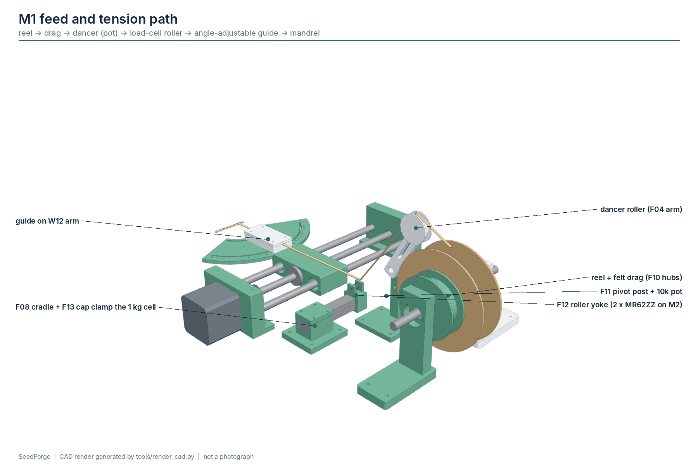

# M1 - Feed + tension

**Build phase:** 1  |  **Status:** core - designed, CAD-checked, not built

## 1. Purpose

Present prepared veneer to the winding guide at a stable, measured tension.

## 2. Inputs

* prepared (wet) veneer strip or blank from the approved lab process
* tension setpoint and trip limit from the recipe

## 3. Outputs

* strip at the guide entry under known tension
* tension samples (HX711) and dancer position (A0 raw, reported in STATUS as dancer=)

## 4. Printed components

* F09 spool stand left (608 pocket, replaces F01)
* F02 spool stand right
* F10 spool hubs x2 (8 mm bore, replace F03)
* F04 dancer arm + F05 rollers
* F11 dancer pivot post
* F08 load-cell cradle + F13 clamp cap
* F12 sensing-roller yoke
* F06/F07 veneer guide (carried by W12)

## 5. Purchased components

* 8 mm axle in 2 x 608ZZ
* felt washers (drag)
* 10 kOhm pot with 6 mm shaft (dancer pivot)
* light extension spring
* 1 kg bar load cell + HX711
* 2 x MR62ZZ (2 x 6 x 2.5 mm) on an M2 x 16 screw axle (sensing roller)
* M2 screws only (thread-forming into printed pilots, wood screws into plywood)

## 6. Electronics

* HX711 DOUT/SCK -> Uno D11/D12
* dancer pot wiper -> Uno A0

## 7. Software responsibility

* firmware: two consecutive samples above SET_TENSION_MAX trip SAFE_STOP (TENSION_HIGH); PRETENSION waits for SET_TENSION_MIN
* firmware: optional speed trim on tension above setpoint is present but DISABLED (gain 0) until the material window is known
* host: logs TENSION lines per cycle

## 8. Calibration method

* TARE with the strip slack, then CAL_TENSION=<N> with a known hanging mass over the actual roller path
* measure damage and break tension per material lot (Phase 0) before choosing SET_TENSION_MAX
* record the drag setting and dancer angle at the chosen tension

## 9. Acceptance criteria

* 20 consecutive feeds without snag
* tension trace stays inside the experimentally established band
* load-cell calibration repeatable within 5 % over three tare/cal cycles

## 10. Known risks

* guide traverses +-50 mm, so the strip angle between the load-cell roller and the guide changes during a cycle
* dancer and drag are passive: tension depends on friction that changes as felt wets
* IMU vibration is not tension - do not use it as the process variable

## 11. CAD preview

Interactive: the website module explorer loads `phase1_core_cell.glb`. Files: `hardware/cad/glb/phase1_core_cell.glb`, STEP/STL/3MF of every part in `hardware/cad/`.

## 12. Assembly figure

Figures are CAD renders, not photographs, and are not evidence that the module works.
