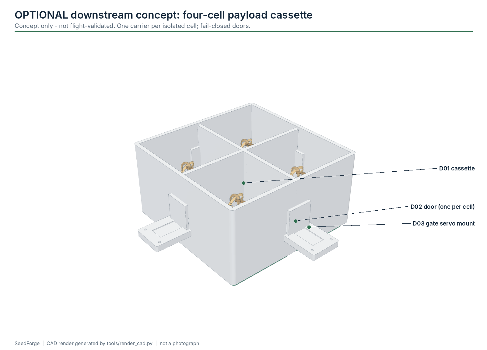

# M10 - Drone cassette (optional, downstream)

**Build phase:** 8  |  **Status:** concept only - not flight-validated

## 1. Purpose

Release one finished carrier at a time at unique, pre-assigned planting points, using a proven aircraft and an independent payload controller.

## 2. Inputs

* finished carriers
* sector plan with unique point IDs
* landowner and aviation permissions

## 3. Outputs

* released carriers with a logged point ID each

## 4. Printed components

* D01 four-cell cassette
* D02 doors x4 (fail-closed)
* D03 servo mounts
* D04 payload rail adapter (not structural)
* D05 Pi plate
* D06 downward camera mount

## 5. Purchased components

* payload kit (about $18): RP2040 board, 4 x SG90 gate servos, 4 x TCRT5000 IR confirm sensors, 5 V BEC, leads
* aircraft if not owned: ArduPilot-supported F405 FC + ESC stack, F450-class frame, 2212 motors, M10 GPS, 3S LiPo
* optional: Pi Zero 2 W + camera for terrain classification

## 6. Electronics

* flight-controller servo/relay output -> RP2040 GPIO (release request at each waypoint)
* RP2040 -> 4 gate servos; 4 IR sensors -> RP2040
* servos on their own 5 V BEC
* see docs/drone-concept.md

## 7. Software responsibility

* seedforge.deploy.ledger: intent persisted before release; uncertain releases are never retried automatically

## 8. Calibration method

* loaded mass and CG
* thrust margin
* door retention and release on the bench, hundreds of cycles

## 9. Acceptance criteria

* only after manufacturing works
* bench release validation
* fail-closed on power loss
* permissions in place

## 10. Known risks

* flight safety
* LiPo fire
* invasive species / unauthorised seed release

## 11. CAD preview

Interactive: the website module explorer loads `payload_cassette.glb`. Files: `hardware/cad/glb/payload_cassette.glb`, STEP/STL/3MF of every part in `hardware/cad/`.

## 12. Assembly figure

Figures are CAD renders, not photographs, and are not evidence that the module works.
