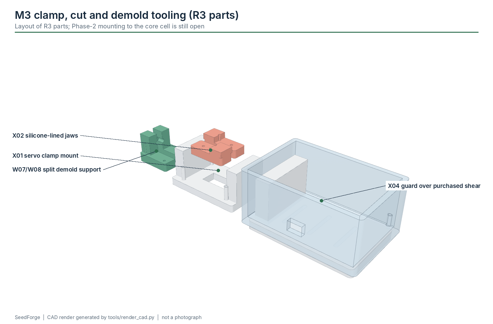

# M3 - Clamp + cut + demold

**Build phase:** 2  |  **Status:** core - sequence SOFTWARE-TESTED (host tests + simulator); mounting to the core cell open

## 1. Purpose

Hold only the sacrificial region, cut with a guarded purchased shear, support the wet coil in a compliant split fixture and withdraw the mandrel without dragging the coil over an undercut.

## 2. Inputs

* accepted wet coil on the mandrel (VERIFY passed)
* SET_M3=1, SET_DEMOLD=<mm>

## 3. Outputs

* free wet body in the open split support, ready for the drying tray

## 4. Printed components

* X01 servo clamp mount
* X02 soft clamp jaws x2 (1 mm silicone)
* X03 guarded shear mount
* X04 guard (polycarbonate for final)
* W07/W08 split demold support (experimental)

## 5. Purchased components

* 3 x MG90S servo
* PCA9685
* spring-return micro shear
* silicone sheet / PTFE tape
* optional guard interlock switch (A3)

## 6. Electronics

* PCA9685 CH0 clamp, CH1 cutter, CH6 demold support on the 5 V servo rail (cut by the E-stop)
* guard NC switch -> A3 (optional)

## 7. Software responsibility

* CLAMP -> CUT (stroke, rest) -> DEMOLD (support close, relative axial retraction, support open, clamp release) -> COMPLETE
* guard open during CUT -> SAFE_STOP (GUARD_OPEN)

## 8. Calibration method

* tune servo pulse widths (constants in sf_controller.h) with the linkage disconnected first
* find the minimum clamp force that holds the sacrificial tail
* measure the wet coil OD; size the W07/W08 silicone lining

## 9. Acceptance criteria

* 20/20 successful cut + release cycles
* no visible delamination from clamp or demold
* coil never dragged over a closed undercut

## 10. Known risks

* mechanism placement not designed yet (W07 pocket axis 17 mm vs 37 mm)
* cut debris near the mandrel
* pinch points: guard the shear

## 11. CAD preview

Interactive: the website module explorer loads `m3_clamp_cut_demold.glb`. Files: `hardware/cad/glb/m3_clamp_cut_demold.glb`, STEP/STL/3MF of every part in `hardware/cad/`.

## 12. Assembly figure

Figures are CAD renders, not photographs, and are not evidence that the module works.
