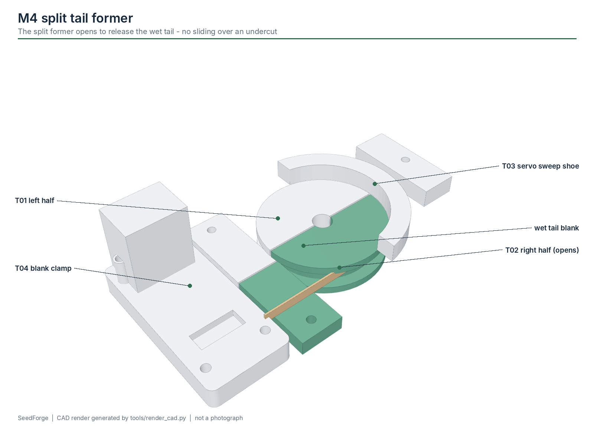

# M4 - Auxiliary tail forming

**Build phase:** 3  |  **Status:** experimental - R3 fixture parts, not built

## 1. Purpose

Form the two auxiliary tails as a separate bench module first, so tail variables are isolated from body winding.

## 2. Inputs

* wet tail blanks (27 / 29.5 / 32.5 mm path length references)

## 3. Outputs

* formed wet tails released without tearing

## 4. Printed components

* T01/T02 split former halves (14 mm radius, 4.8 mm channel)
* T03 servo sweep shoe (needs repair: detached tab)
* T04 blank clamp

## 5. Purchased components

* 2 x MG90S (sweep CH2, clamp CH3)
* PTFE tape for the shoe

## 6. Electronics

* PCA9685 CH2/CH3

## 7. Software responsibility

* future TAIL_FORM state (not implemented in v0.3)

## 8. Calibration method

* sweep angle and dwell per material lot
* dried tail shape vs PR02-PR04 envelopes

## 9. Acceptance criteria

* tails release wet without tearing
* dried shape repeatable enough to seat in S04
* three tails sit 120 deg apart without forcing

## 10. Known risks

* former radius is a starting value
* spring-back during drying unknown

## 11. CAD preview

Interactive: the website module explorer loads `tail_former.glb`. Files: `hardware/cad/glb/tail_former.glb`, STEP/STL/3MF of every part in `hardware/cad/`.

## 12. Assembly figure

Figures are CAD renders, not photographs, and are not evidence that the module works.
