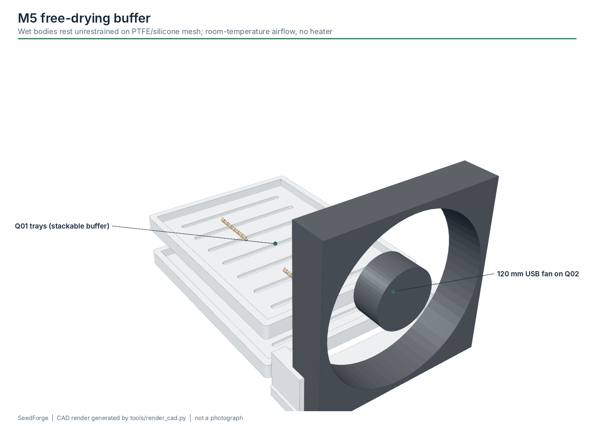

# M5 - Free drying

**Build phase:** 4  |  **Status:** experimental

## 1. Purpose

Let wet bodies and tails dry unrestrained so no fixture forces the final geometry; an asynchronous buffer between forming and assembly.

## 2. Inputs

* wet bodies/tails with carrier IDs

## 3. Outputs

* dry parts with logged drying history

## 4. Printed components

* Q01 free-dry trays (x4)
* Q02 120 mm fan bracket

## 5. Purchased components

* 120 mm USB fan
* PTFE/silicone mesh liner
* temperature/RH sensor

## 6. Electronics

* optional I2C temp/RH on the host or ESP32

## 7. Software responsibility

* host log: material lot, recipe, timestamp, temperature, humidity, tray position, dry release time, dry dimensions

## 8. Calibration method

* measure mass loss over time on a sample tray to define 'dry'

## 9. Acceptance criteria

* dry geometry stable enough to assemble
* no fixture-induced flattening or permanent deformation

## 10. Known risks

* sticking to the liner
* uneven airflow -> uneven drying

## 11. CAD preview

Interactive: the website module explorer loads `drying_station.glb`. Files: `hardware/cad/glb/drying_station.glb`, STEP/STL/3MF of every part in `hardware/cad/`.

## 12. Assembly figure

Figures are CAD renders, not photographs, and are not evidence that the module works.
