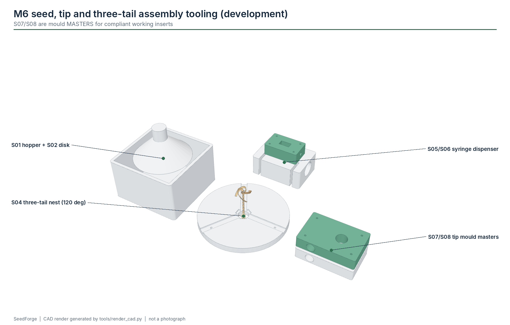

# M6 - Seed + tip + three-tail assembly

**Build phase:** 5  |  **Status:** experimental development tooling

## 1. Purpose

Place the dry body and two auxiliary tails 120 deg apart, present exactly one seed, apply a small adhesive dose only to inactive joints, form the biodegradable tip.

## 2. Inputs

* dry body + tails
* seeds of the chosen species
* validated adhesive and tip paste

## 3. Outputs

* assembled carrier

## 4. Printed components

* S04 three-tail nest
* S01 hopper (needs repair) + S02 singulator disk
* S03 indexer mount
* S05/S06 syringe dispenser
* S07/S08 tip mould MASTERS (cast compliant working inserts)

## 5. Purchased components

* 2 x 28BYJ-48 + ULN2003
* MCP23017
* 10 mL syringes + blunt needles
* moulding silicone
* M5 threaded rod (syringe drive screw - a motion part, not a fastener)

## 6. Electronics

* MCP23017 GPA0-3 / GPB0-3 -> ULN2003 boards

## 7. Software responsibility

* future ASSEMBLE state; early tests use manual seed presentation

## 8. Calibration method

* seed pocket size per species
* adhesive dose per joint by mass

## 9. Acceptance criteria

* exactly one seed
* exactly three tails retained
* no adhesive on active coils
* tip survives handling
* seed viability acceptable

## 10. Known risks

* do not heat live seed unless viability testing supports it
* adhesive wicking onto active coils

## 11. CAD preview

Interactive: the website module explorer loads `assembly_station.glb`. Files: `hardware/cad/glb/assembly_station.glb`, STEP/STL/3MF of every part in `hardware/cad/`.

## 12. Assembly figure

Figures are CAD renders, not photographs, and are not evidence that the module works.
