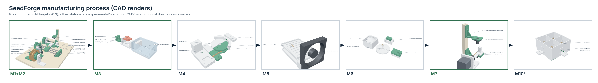

# M9 - XY transfer (optional)

**Build phase:** 7  |  **Status:** upcoming - start manually

## 1. Purpose

Move fixtures or parts between proven stations, gripping only handling tabs or fixtures - never the active coil.

## 2. Inputs

* parts in fixtures at station pick points

## 3. Outputs

* parts placed at the next station

## 4. Printed components

* R01 tool plate
* R02 gripper body + R03 fingers
* R04 carriage adapter
* R05/R06 corner mounts
* R07 carriage
* R08 Z servo mount

## 5. Purchased components

* donor 3D-printer XY gantry (keeps its own hardware; R parts attach with M2)
* 2 SG90 servos (grip CH4, Z CH5)

## 6. Electronics

* separate motion node recommended (the Uno timing budget is for winding)

## 7. Software responsibility

* future TRANSFER state

## 8. Calibration method

* station pick/place coordinates after homing

## 9. Acceptance criteria

* >= 50 transfers without drop or collision
* safe homing
* power loss cannot drop the Z axis into a hazard

## 10. Known risks

* collisions with stations
* gripping the wet coil

## 11. CAD preview

Parts only (no assembly yet): see `hardware/cad/manifest.csv`.

## 12. Assembly figure

Figures are CAD renders, not photographs, and are not evidence that the module works.
