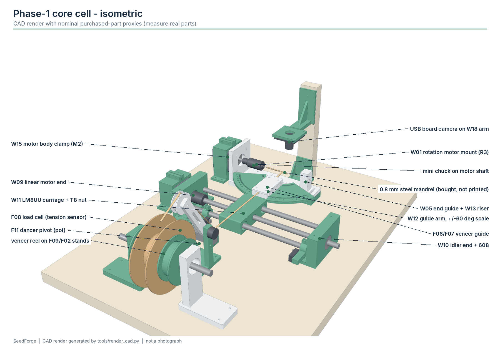
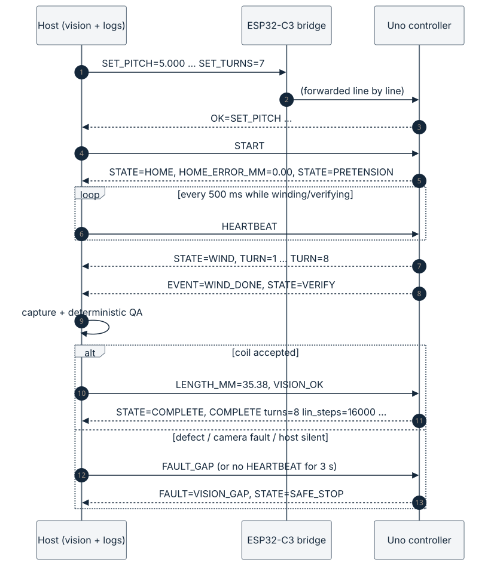

# System overview

SeedForge splits carrier manufacturing into ten replaceable modules on a shared electrical and
software backbone. This page shows how the parts fit together; each module has its own page in
[modules/](modules/README.md).

## Physical layout (Phase-1 core cell)

| item | position (R3.1 layout, mm) | notes |
|---|---|---|
| plywood base | x -120...260, y -377...130 | 18 mm; drilled from `hardware/drawings/core_cell_drilling_template.svg`; every fastener is M2 |
| mandrel axis | z = 37.0, along +x from the chuck (jaws at x = 21) | datum set by W01 |
| W05 end support | x = 104 on the W13 11 mm riser | PTFE bushing |
| traverse axis | y = -127, z = 22, rods 56 mm apart, 250 mm long | W09 motor end, W10 idler end |
| home / end switches | carriage x = 45 / 149 | firmware travel limit 100 mm from home |
| guide (W12 + F06/F07) | on the carriage, exit 27 mm from the contact point | -60...+60 deg |
| spool / dancer / load cell | y = -317 / -242 / -205 | strip runs toward +y to the guide |
| camera / back-light | USB board camera on W18 over x = 70, lens about 50 mm above the mandrel; plywood mast at y 62-80 / LED back-light under the mandrel x 36-96, z 20-23 | silhouette imaging |

Collision-free carriage windows from the CAD sweep: x = 45-150 mm for guide angles -45...+45 deg,
60-120 mm at -60 deg, 85-150 mm at +60 deg. This is CAD-VALIDATED only.

## Control layers

1. **Arduino Uno - real-time core.** Owns everything that moves or stops: Timer1 step generation,
   synchronisation, homing, limits, tension trip, E-stop feedback, heartbeat watchdog, the state
   machine and the M3 servo sequence. It keeps working, and stops safely, if the bridge or host
   disappears. See [controls.md](controls.md).
2. **XIAO ESP32-C3 - optional bridge and operator display.** Forwards complete protocol lines between the
   Uno and hosts on USB, BLE and optional Wi-Fi; draws state, fault, turn and tension on the
   ILI9341 display. It never invents commands or heartbeats, so it cannot keep a machine alive that
   the host has abandoned.
3. **Host - laptop or Raspberry Pi.** Runs the recipe, camera capture and deterministic vision QA,
   sends `HEARTBEAT`, `VISION_OK` or `FAULT_*`, and writes the CSV run log. Camera frames never go
   to the Uno. See [computer-vision.md](computer-vision.md).
4. **Hardware safety chain.** The E-stop's NC contact removes 12 V from both stepper drivers and the
   servo buck. A resistor divider from the switched rail tells the Uno (D8), which then reports
   `ESTOP_OPEN`. See
   [electronics.md](electronics.md#safety-circuit-concept).

## One cycle

1. Host sends the recipe (`SET_PITCH`, `SET_TURNS`, ...) and `START`.
2. Uno re-homes and checks the home position against the last one (skipped-step evidence).
3. `PRETENSION`: carriage moves to the start position; if tension is required, waits until the load
   cell reads at least `SET_TENSION_MIN` for 300 ms.
4. `WIND`: both motors run in Bresenham lock-step with a trapezoidal ramp; `TURN=n` lines report
   progress, `TENSION=` every 0.5 s.
5. `VERIFY`: the host captures an image and replies `VISION_OK` or a `FAULT_*`. Timeout 15 s.
6. If M3 is enabled: `CLAMP`, `CUT`, `DEMOLD` (servo moves plus a relative axial retraction).
7. `COMPLETE turns=... lin_steps=... pitch_mm=... length_mm=...`; host writes the carrier row.

Any unsafe condition goes to `SAFE_STOP`, which disables the drivers and waits for a deliberate
`RESET` (see [controls.md](controls.md#state-machine)).

## Data

Each cycle gets a carrier ID. `carriers.csv` holds one row per carrier (recipe, material lot,
tension statistics, vision verdict, result); `trace.csv` holds the time series. See
[validation.md](validation.md#run-logging).

## Software map

| path | language | runs on | tested by |
|---|---|---|---|
| `firmware/arduino/seedforge_core` | C++ (Arduino) | Uno | `tests/firmware` (host build, ASan/UBSan), arduino-cli compile |
| `firmware/esp32/seedforge_bridge` | C++ (Arduino) | XIAO ESP32-C3 | arduino-cli compile |
| `software/seedforge/geometry.py` | Python | host | `tests/geometry` |
| `software/seedforge/protocol.py` | Python | host | `tests/host/test_protocol.py` |
| `software/seedforge/simulator` | Python | host | `tests/host/test_simulator.py`, parity with the C++ core |
| `software/seedforge/host` | Python | host | `tests/host/test_recipe_runner.py` |
| `software/seedforge/vision` | Python + OpenCV | host | `tests/host/test_vision.py` |
| `software/seedforge/deploy` | Python | companion computer (concept) | `tests/host/test_ledger.py` |
| `website/` | TypeScript + Three.js | browser | `npm run build` in CI |
